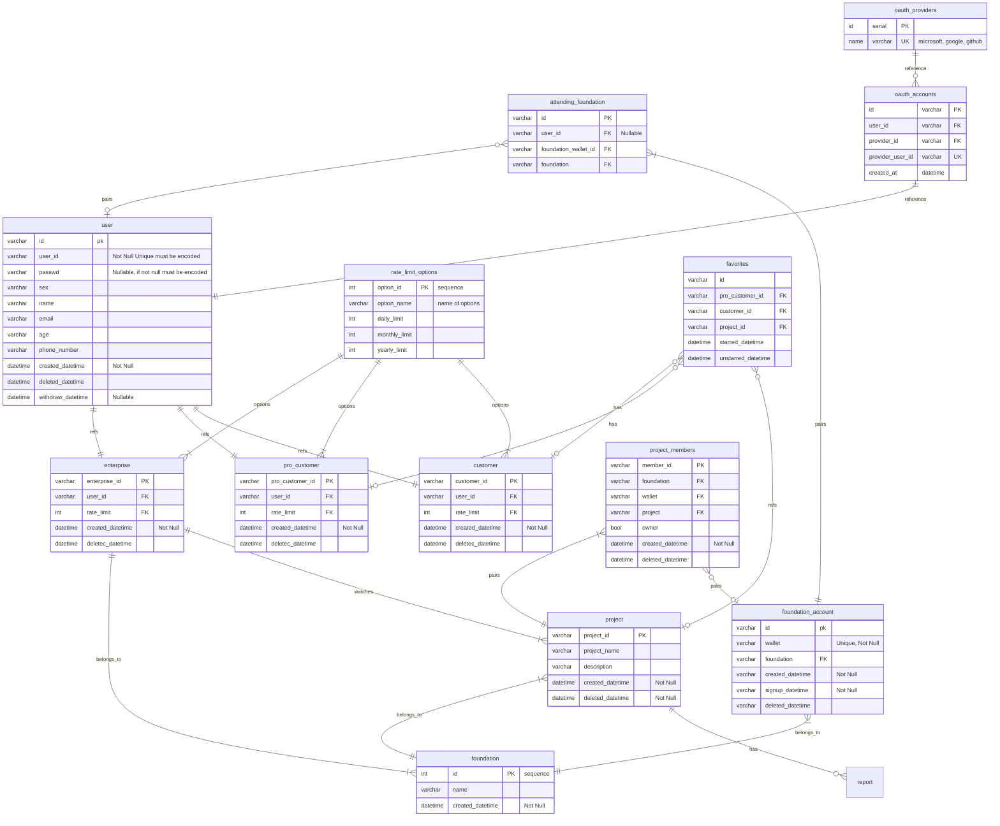
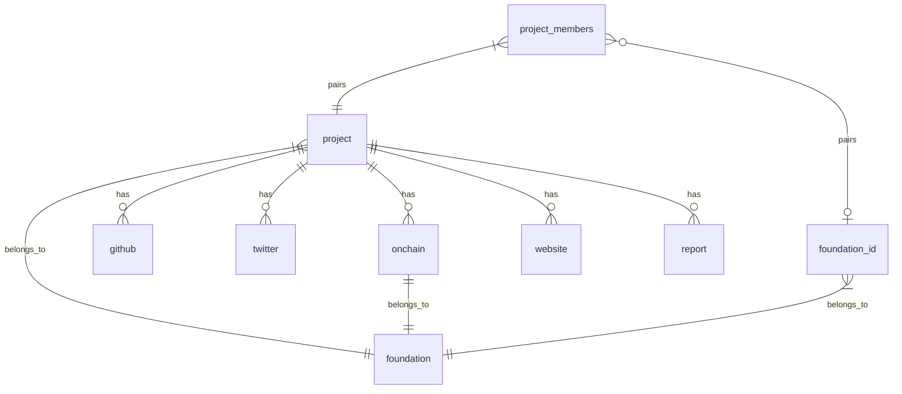
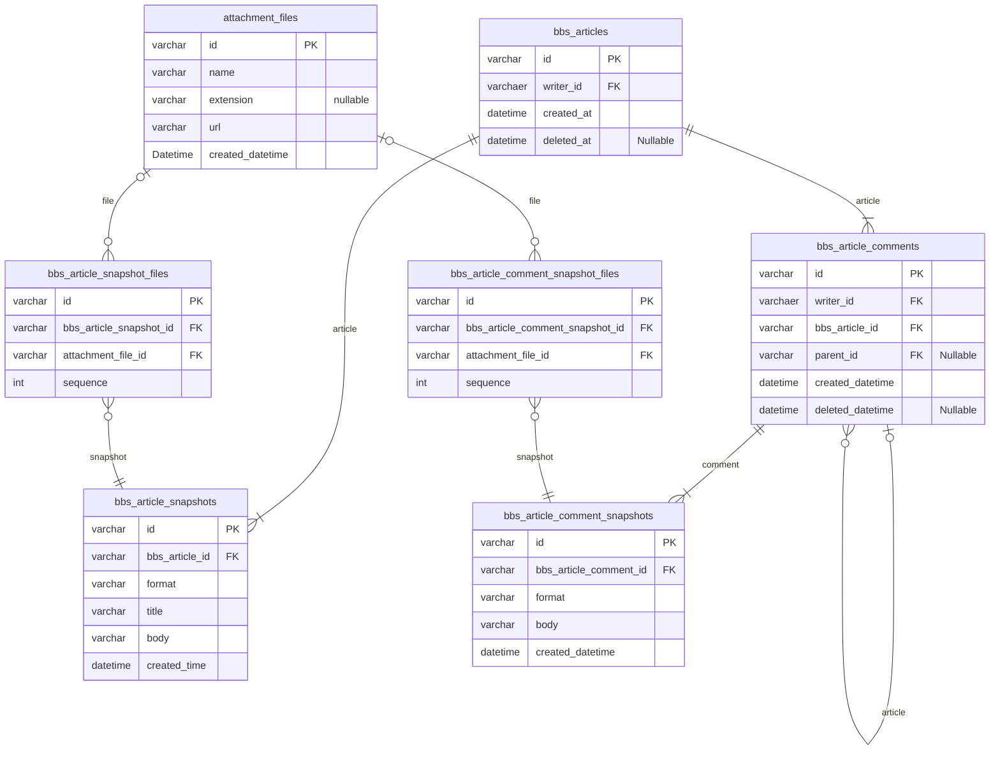
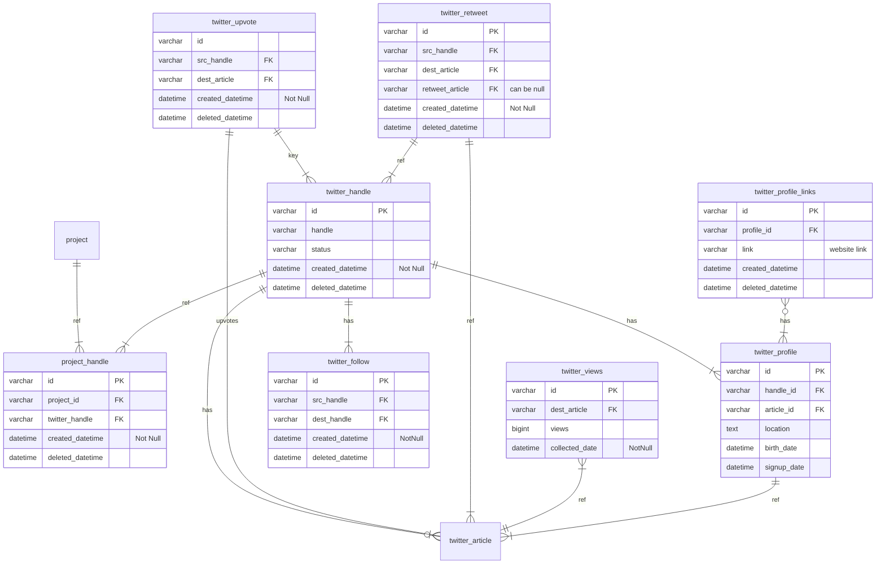
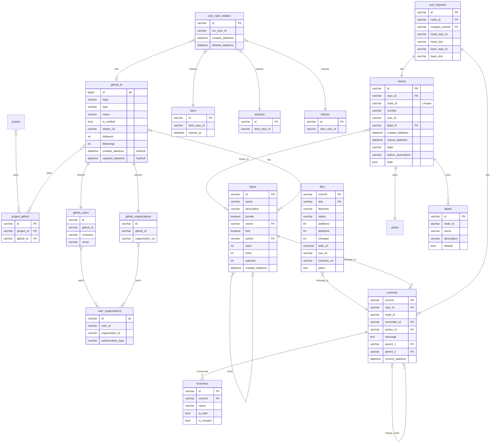
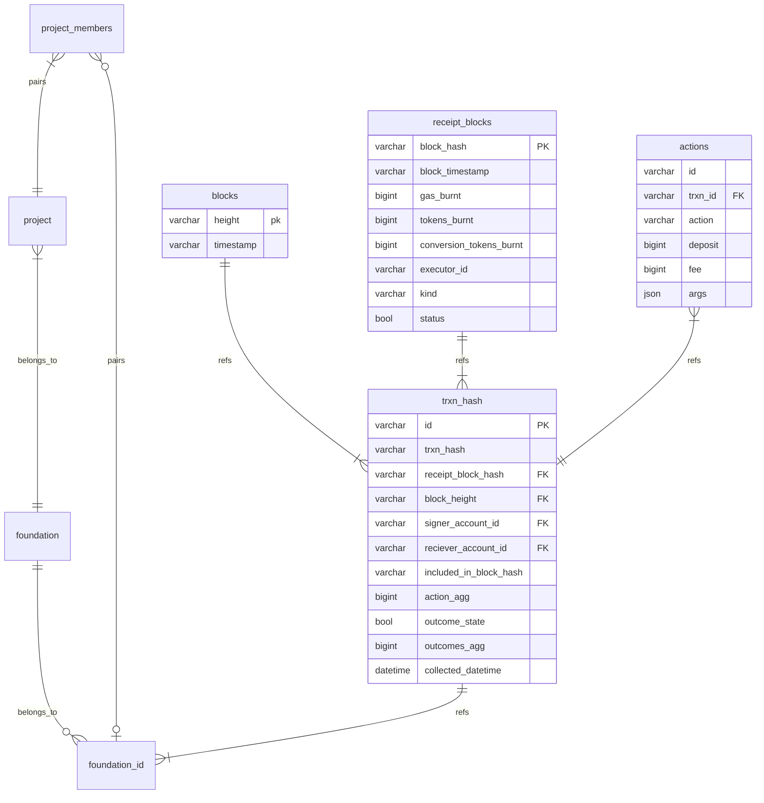
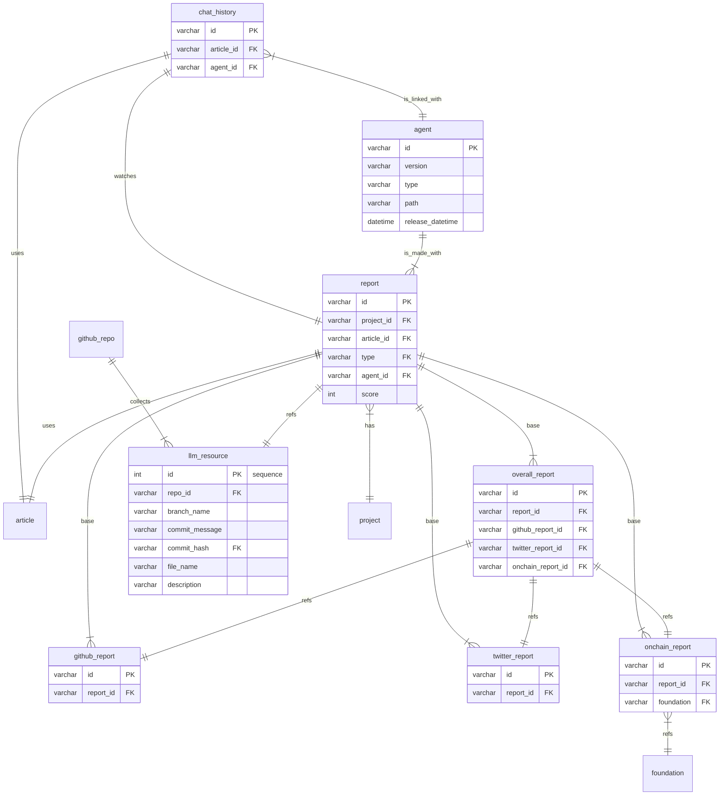

## User Group

**User Table**

User 테이블은 각 사용자 그룹이 공통적으로 갖고 있는 속성들의 집합입니다. 모든 세부 유저 테이블은 User 테이블을 상속한 후에 각 테이블에서 필요한 속성은 따로 정의하여 저장하고 사용합니다. 이는 각 유저별 권한 관리와 유저의 인증을 유연하게 하기 위함입니다. 예를 들어, 한 사용자가 customer -> procustomer로 변경이 된다고 가정할 때, user 테이블의 데이터를 삭제하거나 따로 추가적으로 갱신할 필요 없이, 해당 유저를 customer에서 비활성 처리하고 procustomer 테이블에 추가하면 됩니다. 또한 다양한 행위의 권환 관리에서 일일이 유저를 조회한 후에 특정 컬럼의 속성을 조회하는 것보다 해당 테이블에 `in` 연산을 날려서 조회의 성능 역시 향상합니다. 또한 한 개인의 계정이 enterprise와 procustomer/customer 엮여 있을 때 역시 조회가 가능합니다.

**customer**

일반 사용자로서 무료로 플랫폼에 참여하는 유저입니다. 유저는 만약 자신의 지갑 정보를 입력했다면, 계정 정보를 토대로 자신이 투자한 프로젝트의 정보와 자신이 관심있게 지켜보는 프로젝트를 조회할 수 있습니다. 제공받는 서비스는 같지만 양에 제한이 있습니다.

**pro_customer**

유료 구독 플랜 계정 사용자입니다. 저는 만약 자신의 지갑 정보를 입력했다면, 계정 정보를 토대로 자신이 투자한 프로젝트의 정보와 자신이 관심있게 지켜보는 프로젝트를 조회할 수 있습니다. 일반 유저와는 기본적으로 서비스의 범위는 같지만, 양에 제한이 없습니다.

**enterprise**

기업용 계정 테이블입니다. 해당 계정은 재단 계정 테이블로서 재단에 속한 프로젝트들만 조회가 가능합니다.

**Oauth_accounts**

Oauth를 통해 가입한 사용자들의 정보를 저장하기 위한 테이블입니다.

**Oauth_providers**

Oauth 제공사가 늘어날 경우와 Oauth의 제공 범위를 늘리기 위해 제작한 테이블입니다.

**rate_limit_options**

레이트 리밋 옵션 테이블로서, 일일, 주별, 월별 사용량의 옵션을 적어놓은 테이블입니다. 각 사용자는 해당 옵션의 id를 참조함으로써 사용량 제한이 결정됩니다. 새로운 옵션이나 구체적인 다른 옵션의 제한은, 칼럼의 추가와 레코드의 추가로 커스텀하여 제작이 가능합니다.

**foundation**

재단의 정보를 모아 놓은 테이블입니다. 현재 프로젝트가 집중하고 있는 니어 프로토콜 이외의 다른 코인 재단에서 활동하는 프로젝트 역시 모으기 위해 제작되었습니다.

**foundation_account**

각 코인 회사에 속한 지갑 주소의 테이블입니다. 프로젝트의 지갑 주소 이외에, 개인 사용자의 지갑 주소 등이 속해있습니다. 

**project**

각 재단의 후원 프로젝트에 참여하는 프로젝트들의 정보입니다. 추가적으로 아래의 속성이 추가 될 수 있습니다.

- 대표이미지
- 웹사이트

**project_members**

프로젝트에 참여하고 있는 프로젝트 멤버의 테이블입니다. 기본적으로 다대다 관계의 테이블입니다. 이유는 한 사용자가 여러 프로젝트에서 활동할 경우의 수가 존재하고 있기 때문입니다.

**attending_foundation**

사용자와 재단 지갑 주소의 테이블입니다. 한 사용자가 여러 코인 재단의 계정을 갖고 있을 수 있으므로 일대다 관계를 갖고 있습니다. 이 테이블을 통해 만약 사용자가 투자한 프로젝트가 있다면 이를 통해 조회가 가능합니다.

**favorites**
사용자가 관심 있어 하는 프로젝트의 목록을 테이블화 하였습니다. 해당 테이블을 통해 사용자가 관심있게 지켜보는 프로젝트들을 관리 가능합니다.
## project -- relation

**project**
변형된 아티클 패턴을 가지고 있어야 함. 
- 소개글
- 멤버
- 대표이미지
- 깃허브 주소
- twitter 주소
- 웹사이트
- 온체인 활동

**foundation**
한결님을 통해서 어떤 정보를 가지고 있는지 좀 더 알아야 함

**github**
- 경수가 써놓은 노션글을 통해 일단 ERD를 가져올 예정

**twitter**
- 트위터 역시 아티클 패턴으로 데이터를 거의 다 가져와야 함

**onchain**
- 온체인 데이터는 혹시 먼저 니어 이외의 다른 데이터들을 볼 수 있으면 더 좋을 듯 함

**report**
- report가 foundation 자체의 활동도 보게 될까??

**추가 테이블 가능성**
- 디스코드, 텔레그램 --> 결국 자발적으로 우리한테 데이터를 지원해야 가능한 부분
## Twitter -- relation

위는 twitter의 정보를 저장하기 위해 활용될 article 패턴

**twitter_handle**

이는 트위터의 계정정보테이블입니다. status 칼럼을 통해 해당 계정의 활성 상태를 파악할 수 있습니다

**project_handle**

project와 트위터의 계정을 연결해주는 pair 테이블입니다. 해당 테이블은 project와 twitter 계정 간의 다대다 관계를 제어하기 위한 테이블입니다. 

**twitter_follow**

팔로우 관계를 추적하기 위한 테이블입니다. 해당 테이블은 두개의 키 모두 twitter_handle을 참조하고 있습니다.

**twitter_upvote**

트위터의 좋아요의 활동을 추적하기 위한 테이블입니다.

**twitter_retweet**

트위터의 리트윗 활동을 추적하기 위한 테이블입니다. retweet 동작은 두 가지로 나뉘어져 존재하고 있습니다. 자신의 의견을 더하지 않고 retweet을 진행할 경우는 기존의 게시글을 바라보기만 하면 되지만, 자신의 의견을 더하여 retweet을 진행할 경우 새로운 게시글을 생성하는 형태가 되기 때문에 아티클 패턴을 참조하고 있습니다.

**twitter_views**

게시글의 조회수를 추적하기 위한 테이블입니다. 조회수의 경우 누가 어떤 게시글을 조회했는지에 대한 정보를 api에서 제공하지 않기 때문에 반복적인 수집을 통해 게시글에 대한 engagement를 추적합니다.

**twitter_profile**

트위터 프로필 정보를 저장하는 테이블입니다.

**twitter_profile_links**

트위터의 프로필에 바인딩 된 외부 링크에 대한 정보를 저장하는 테이블입니다. 해당 테이블을 통해 외부링크를 저장할 수 있습니다.

**twitter_article**

트위터의 게시글 내용 자체를 수집하기 위한 패턴입니다. 위의 아티클 패턴을 참조해주시기 바랍니다.
## github -- relation

**project_github**

project와 github의 계정을 다대다 관계로 연결하기 위한 pair 테이블입니다.

**github_id**

 users와 organization 정보에 공통 속성으로 존재하는 github_id 정보를 담은 테이블입니다. organization도 하나의 user로 깃허브에선 취급하기에 다음과 같이 상속 테이블의 형태로 나누어 저장합니다.

**github_users**

**github_organizations**

- 브랜치의 브랜치의 경우 어차피 커밋에 있는 브랜치의 최우선 커밋을 바라보면 됨

Issue
- 아티클 패턴이 적용되어야 함

files
- branch가 커밋에서 나온 거기 때문에, file 역시도 브랜치로 향해야함

pulls
- issue에서 가져오는 속성이기 때문에 issue 테이블 안에 있는 특정 레코드를 참조하고 기다림

## onchain -- relation

## report -- ralation

**report**

에이전트가 생성하는 레포트의 베이스 테이블입니다. type 칼럼을 통해 llm_resource를 참조하여, 레포트의 버저닝을 가능하도록 합니다. 또한, 해당 레포트를 사용하는데 사용된 에이전트를 참조하여 레포트 뿐만 아니라 레포트를 생성하는 에이전트의 버저닝과 레포트의 퀄리티를 추적 가능하도록 합니다.

레포트가 혹시 변경될 수 있으므로, 아티클 패턴을 사용하여 관리합니다.

**twitter_report**
레포트 테이블을 참조하고 있으며, 트위터의 레포트만을 따로 저장하고 있는 테이블입니다.

**onchain_report**
레포트 테이블을 참조하고 있으며 온체인 레포트만을 따로 저장하고 있는 테이블입니다. 추가적으로 어떤 재단의 활동에 대한 레포트인지도 추가적으로 저장합니다.

**github_report**
레포트 테이블을 참조하고 있으며 깃허브 레포트만을 따로 저장하고 있는 테이블입니다.

**overall_report**

각 레포트를 다 참조하고 있으며 다른 활동을 종합적으로 살펴본 후에 만들어지는 총괄 레포트입니다. 역시 레포트 테이블을 참조하고 있습니다.

**chat_history**

레포트에 대해 추가적으로 에이전트한테 질문과 응답을 한 데이터를 저장하는 테이블입니다. 사용자는 이를 통해 관심 레포트에 추가적인 탐색을 진행할 수 있으며 그 내역을 저장하기 위한 테이블입니다. 역시 에이전트 테이블을 참조하여 채팅 내역을 생성하는 에이전트에 대한 버저닝과 성능 추적이 가능합니다.
## Case another

유저가 직접 자기가 보고 싶은 프로젝트를 삽입하는 경우
